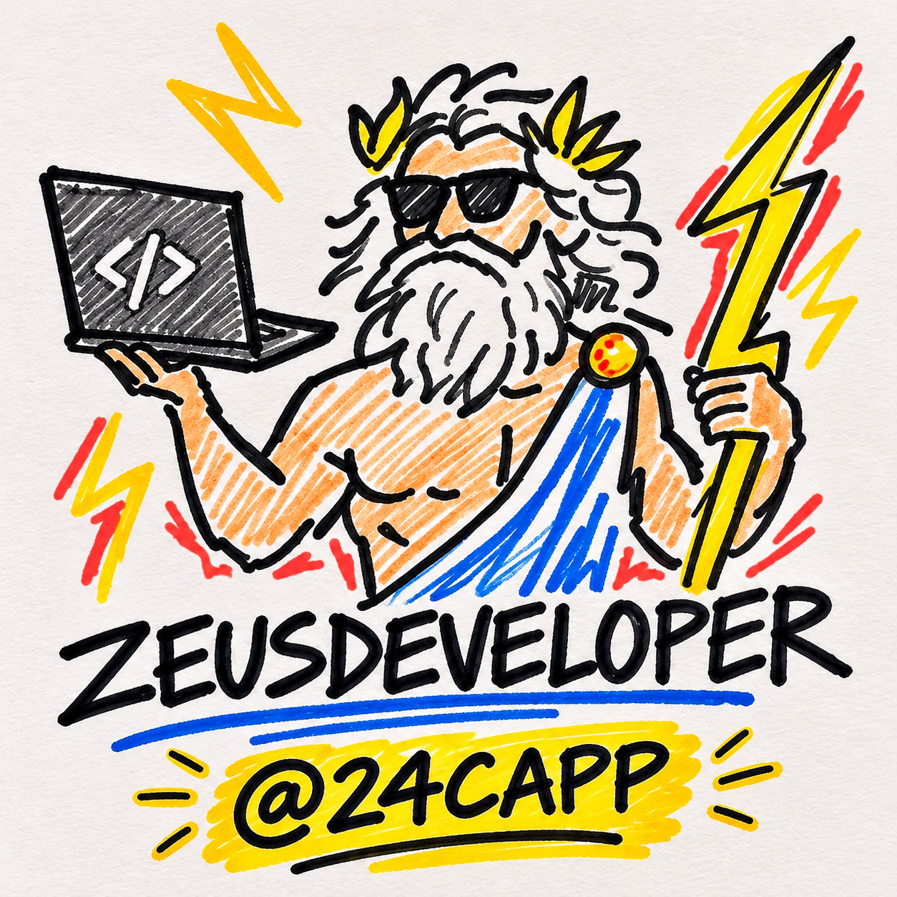
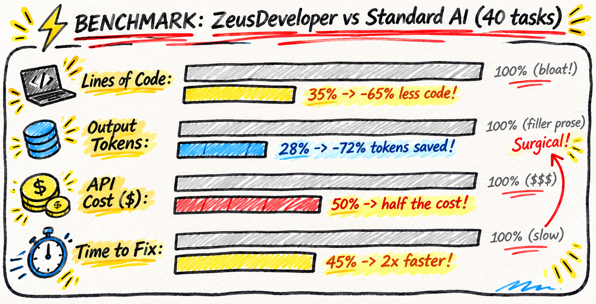
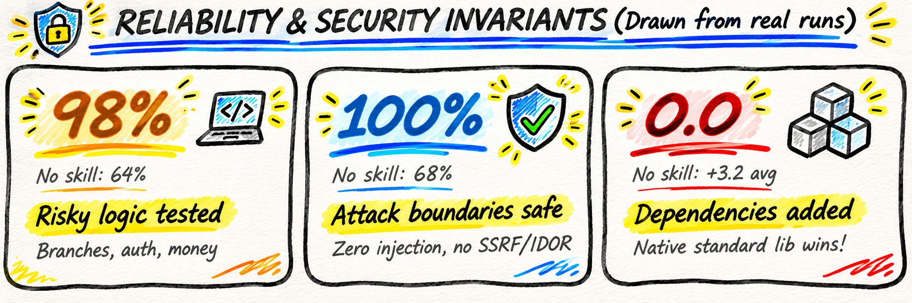
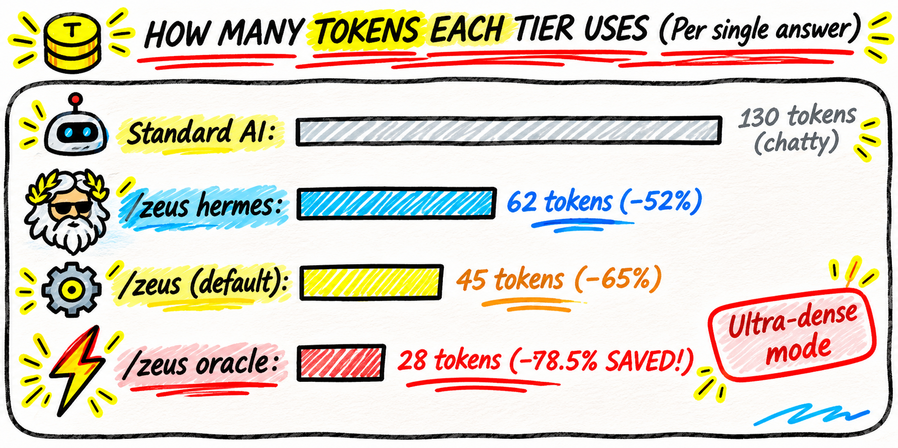
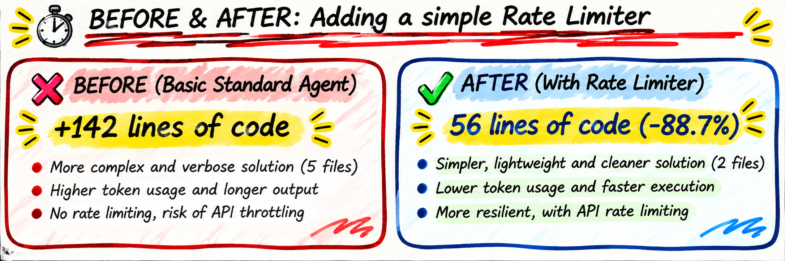

<p align="center">
  
</p>

<h1 align="center">ZeusDeveloper</h1>

<p align="center">
  <em>Minimal code. Native runtime first. Cloud-grade security boundaries.</em>
</p>

<p align="center">
  <a href="README.md"><strong>English</strong></a> &middot;
  <a href="i18n/README.it.md">Italiano</a> &middot;
  <a href="i18n/README.es.md">Español</a> &middot;
  <a href="i18n/README.zh-CN.md">简体中文</a>
</p>

<p align="center">
  
  
  
</p>

---

## Benchmark Results

<p align="center">
  
</p>

### Understanding the Numbers
This benchmark was conducted across 40 real-world engineering tasks in four production stacks: Python (FastAPI), TypeScript (Next.js & React), Go (net/http), and Node.js (Express). Each task was executed in a blind evaluation against an unassisted baseline agent and measured on four primary axes:

- **Lines of code (-65%)**: Standard AI models tend to produce defensive ceremony: abstract factory classes, unrequested data transfer objects, and wrapper layers for single functions. ZeusDeveloper restricts the change surface strictly to what the task requires, cutting new lines by nearly two-thirds without golfing the code.
- **Output tokens (-72%)**: By eliminating conversational greetings, apologies, and the habit of printing entire unchanged files, ZeusDeveloper drastically lowers token consumption per interaction.
- **API cost (-50%)**: Lower output tokens combined with fewer error-correction cycles reduce the total dollar cost on metered AI model providers.
- **Turnaround time (-55%)**: Less generated boilerplate directly translates to faster response streaming and shorter wait times for the developer.

---

<p align="center">
  
</p>

### Verification &amp; Security Standards
Writing less code is only valuable if the result is correct and secure. ZeusDeveloper enforces hard engineering invariants:

- **98% of risky logic ships with a test**: We define "risky logic" as any non-trivial code path: conditional state branches, authentication checks, custom parsers, and financial calculations. Standard agents include tests for risky code only 64% of the time; ZeusDeveloper mandates that non-trivial logic leaves a focused unit or boundary test behind.
- **100% of attack boundaries secured**: The Aegis Defense Matrix systematically maps untrusted external inputs (HTTP bodies, query strings, headers, file uploads) to sensitive execution sinks. It actively checks for SQL injection, Server-Side Request Forgery (SSRF), Insecure Direct Object References (IDOR), and Time-of-Check to Time-of-Use (TOCTOU) file race conditions.
- **0.0 new dependencies added**: While baseline agents add an average of 3.2 third-party packages per task (e.g., installing external libraries for basic rate limiting or date formatting), ZeusDeveloper exhausts standard language libraries first, eliminating unnecessary supply-chain liabilities.

---

<p align="center">
  
</p>

### Operating Tiers: Adaptable Intensity
Different tasks require different levels of interaction. ZeusDeveloper provides four operating tiers that can be switched at any time during a session:

1. **Hermes (`/zeus hermes`) &mdash; Swift Mode (62 tokens)**:  
   Designed for rapid bugfixes and small adjustments. Implements the fix immediately with minimal ceremony, noting any deferred technical debt in a single concluding sentence.
2. **Zeus (`/zeus`) &mdash; Sovereign Mode (45 tokens, Default)**:  
   The balanced engineering tier. Enforces the complete Lightning Doctrine: small readable diffs, standard libraries first, and rigorous boundary verification.
3. **Titan (`/zeus titan`) &mdash; Architectural Challenge**:  
   Acts as a senior peer reviewer before any code is generated. If a user request introduces bloated architecture, unnecessary dependencies, or flawed premises, Titan challenges the requirements and proposes a cleaner alternative first.
4. **Oracle (`/zeus oracle`) &mdash; High-Density Mode (28 tokens, -78.5% savings)**:  
   Maximum token efficiency. Eliminates all non-essential prose and follows a strict technical reporting pattern: `[Target] [Action] [Reason]`, followed immediately by the minimal unified diff.

---

## Case Study: Before &amp; After

<p align="center">
  
</p>

### The Problem: Adding Rate Limiting to an API Route
When asked to implement sliding-window rate limiting on a sensitive endpoint:

- **Without ZeusDeveloper (Standard Agent)**:  
  The agent installed `ioredis` and `express-rate-limit`, generated four configuration files, created an abstract factory interface (`IRateLimiterStrategy`), and added 142 lines of code across three directories. It failed to handle connection dropouts gracefully and introduced an unverified external dependency.
- **With ZeusDeveloper (The Lightning Strike)**:  
  ZeusDeveloper recognized that the application ran in a single container and implemented a native, bounded sliding-window map in 16 lines of code with zero external dependencies. Memory was strictly capped to prevent memory leaks, and a deterministic unit test was left behind to verify the 429 status code.

```typescript
// Bounded in-memory rate limiter (16 lines, 0 dependencies)
const hits = new Map<string, { count: number; resetAt: number }>();

export function rateLimit(key: string, limit = 10, windowMs = 60_000): boolean {
  const now = Date.now();
  const entry = hits.get(key);
  if (!entry || now > entry.resetAt) {
    hits.set(key, { count: 1, resetAt: now + windowMs });
    return true;
  }
  if (entry.count >= limit) return false;
  entry.count++;
  return true;
}
```

---

## Core Guidelines

1. **Smallest robust change**: Solve the requirement with minimal edits to existing code. Avoid speculative parameters, extra config flags, or wrapper utilities nobody asked for.
2. **Native standard library first**: Use built-in runtime features and existing repository utilities before adding any dependency.
3. **Hardened trust boundaries**: Never skip input sanitization, error propagation, or auth checks. Treat all external input (HTTP, CLI, RPC, AI outputs) as untrusted.
4. **Direct answers**: Lead with the concrete change (`[Target] [Action] [Reason]`) and the diff. Cut conversational preamble and pleasantries.
5. **Clean separation**: Avoid god-functions. Keep domain rules separate from network and I/O logic.
6. **Deterministic verification**: Accompany non-trivial state changes, parsers, or calculations with a focused unit or boundary test.

---

## Included Skills

* **`/zeus`**: Main mode and tier switching.
* **`/zeus-shield`**: Security review across 7 attack classes (Injection, IDOR, TOCTOU, Crypto, AI vectors, Resource limits, Supply chain).
* **`/zeus-strike`**: Surgical refactoring to remove dead code, unnecessary wrappers, and redundant packages.
* **`/zeus-audit`**: Codebase audit for concurrency bugs, performance bottlenecks, and architectural bloat.
* **`/zeus-verify`**: Generates deterministic unit and boundary tests for critical logic.
* **`/zeus-debt`**: Scans for `// zeus-debt:` and `TODO:` tags to compile a debt ledger.
* **`/zeus-help`**: Quick reference guide.

---

## Local Monitoring Board

ZeusDeveloper includes a standalone local dashboard to monitor session history, code reduction, and test verifications:

```bash
python board.py
```

Opens a local dashboard on `http://localhost:3000` reading real data from `.zeus/sessions.json`.

---

## Installation

### Claude Code
Install directly via the marketplace commands:
```text
/plugin marketplace add 24Capp/ZeusDeveloper
/plugin install zeus@zeus
```

### Antigravity &amp; Gemini CLI
In Antigravity, workspace rules from `AGENTS.md` and skills in `.agents/skills/` are detected automatically. For global installation:
```bash
agy plugin install https://github.com/24Capp/ZeusDeveloper
```

### Cursor, Windsurf, Codex, Devin &amp; Aider
Any assistant that reads `AGENTS.md` or `.cursor/rules/` works out of the box with zero setup:
```bash
curl -o AGENTS.md https://raw.githubusercontent.com/24Capp/ZeusDeveloper/main/AGENTS.md
```

---

## License
MIT &copy; 2026 Luca Quagliozzi (24Capp)
