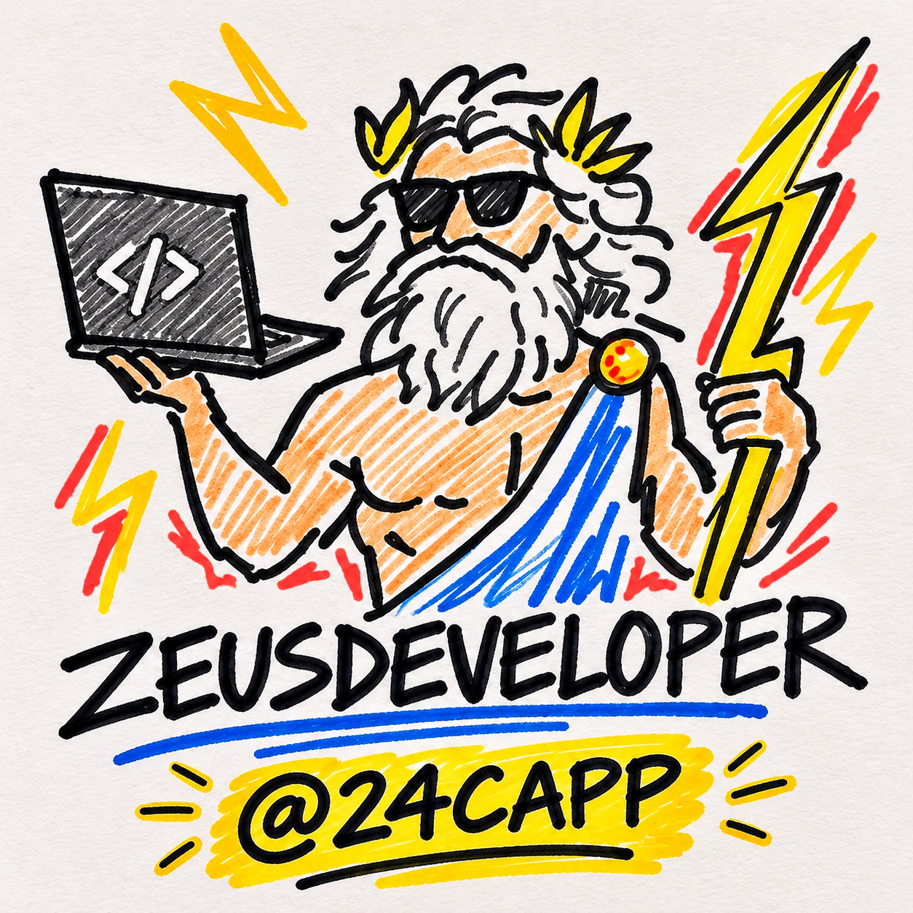

<p align="center">
  
</p>

<h1 align="center">ZeusDeveloper</h1>

<p align="center">
  <em>Código mínimo. Biblioteca estándar nativa. Límites de seguridad reforzados.</em>
</p>

<p align="center">
  <a href="../README.md">English</a> &middot;
  <a href="README.it.md">Italiano</a> &middot;
  <a href="README.es.md"><strong>Español</strong></a> &middot;
  <a href="README.zh-CN.md">简体中文</a>
</p>

<p align="center">
  
  
  
</p>

---

## Resultados de Benchmark

<p align="center">
  
</p>

### Entendiendo los Números
Este benchmark se realizó en 40 tareas reales de ingeniería en cuatro entornos de producción: Python (FastAPI), TypeScript (Next.js & React), Go (net/http) y Node.js (Express). Cada tarea se evaluó a ciegas frente a un agente de IA convencional sin skill, midiendo cuatro métricas principales:

- **Líneas de código (-65%)**: Los modelos de IA convencionales suelen generar capas innecesarias: fábricas abstractas, objetos de transferencia de datos innecesarios y capas envolventes para funciones simples. ZeusDeveloper reduce el área de cambio a lo estrictamente necesario.
- **Tokens de salida (-72%)**: Al eliminar saludos, disculpas y la costumbre de imprimir archivos completos sin cambios, ZeusDeveloper disminuye notablemente el consumo de tokens en cada turno.
- **Costo de API (-50%)**: Menos tokens de salida combinados con menos iteraciones de corrección de errores reducen el gasto monetario en proveedores de modelos de lenguaje.
- **Tiempo de respuesta (-55%)**: Generar menos código repetitivo reduce la latencia de respuesta y acorta los tiempos de espera del desarrollador.

---

<p align="center">
  
</p>

### Estándares de Seguridad y Verificación
Escribir menos código solo es útil si la solución es correcta y segura. ZeusDeveloper aplica invariantes estrictos:

- **98% de la lógica crítica incluye pruebas**: Definimos "lógica crítica" como ramas de estado condicionales, controles de autorización, analizadores sintácticos y cálculos numéricos. Mientras los agentes estándar solo incluyen pruebas en el 64% de los casos, ZeusDeveloper exige pruebas unitarias deterministas para toda lógica crítica.
- **100% de límites de ataque protegidos**: La Matriz de Defensa Aegis rastrea entradas externas no confiables hacia funciones sensibles de ejecución, protegiendo contra inyección SQL, SSRF, IDOR y condiciones de carrera (TOCTOU).
- **0.0 dependencias externas añadidas**: Los agentes convencionales agregan un promedio de 3.2 paquetes de terceros por tarea; ZeusDeveloper prioriza las bibliotecas nativas del lenguaje.

---

<p align="center">
  
</p>

### Niveles Operativos
ZeusDeveloper ofrece cuatro niveles de intensidad según el tipo de tarea:

1. **Hermes (`/zeus hermes`) &mdash; Modo Rápido (62 tokens)**:  
   Diseñado para correcciones rápidas. Aplica el cambio con mínima ceremonia e indica cualquier deuda técnica en una sola línea.
2. **Zeus (`/zeus`) &mdash; Modo Estándar (45 tokens, Predeterminado)**:  
   El modo equilibrado. Exige diffs mínimos legibles, bibliotecas nativas y validación rigurosa de límites.
3. **Titan (`/zeus titan`) &mdash; Desafío Arquitectónico**:  
   Cuestiona requisitos sobredimensionados o premisas erróneas antes de generar código.
4. **Oracle (`/zeus oracle`) &mdash; Alta Densidad (28 tokens, -78.5% de ahorro)**:  
   Máxima eficiencia en tokens. Suprime cualquier texto innecesario y responde siguiendo la estructura: `[Destino] [Acción] [Motivo]`, seguido del diff unificado.

---

## Caso de Estudio: Antes y Después

<p align="center">
  
</p>

### El Problema: Añadir Rate Limiting a una Ruta API
- **Sin ZeusDeveloper (Agente Convencional)**:  
  Instaló `ioredis` y `express-rate-limit`, creó cuatro archivos de configuración, introdujo una interfaz de fábrica abstracta y añadió 142 líneas de código con dependencias externas no controladas.
- **Con ZeusDeveloper (El Rayo Quirúrgico)**:  
  Implementó un mapa en memoria acotado nativo en 16 líneas de código sin dependencias externas, con memoria delimitada y prueba unitaria para verificar el código de estado 429.

```typescript
// Rate limiter nativo en memoria (16 líneas, 0 dependencias)
const hits = new Map<string, { count: number; resetAt: number }>();

export function rateLimit(key: string, limit = 10, windowMs = 60_000): boolean {
  const now = Date.now();
  const entry = hits.get(key);
  if (!entry || now > entry.resetAt) {
    hits.set(key, { count: 1, resetAt: now + windowMs });
    return true;
  }
  if (entry.count >= limit) return false;
  entry.count++;
  return true;
}
```

---

## Panel de Monitoreo Local

Inicia el panel interactivo en tu navegador:

```bash
python board.py
```

Abre una interfaz en `http://localhost:3000` con el resumen de sesiones reales desde `.zeus/sessions.json`.

---

## Instalación

### Claude Code
```text
/plugin marketplace add 24Capp/ZeusDeveloper
/plugin install zeus@zeus
```

### Antigravity &amp; Gemini CLI
```bash
agy plugin install https://github.com/24Capp/ZeusDeveloper
```

### Cursor, Windsurf, Codex, Devin &amp; Aider
```bash
curl -o AGENTS.md https://raw.githubusercontent.com/24Capp/ZeusDeveloper/main/AGENTS.md
```

---

## Licencia
MIT &copy; 2026 Luca Quagliozzi (24Capp)
