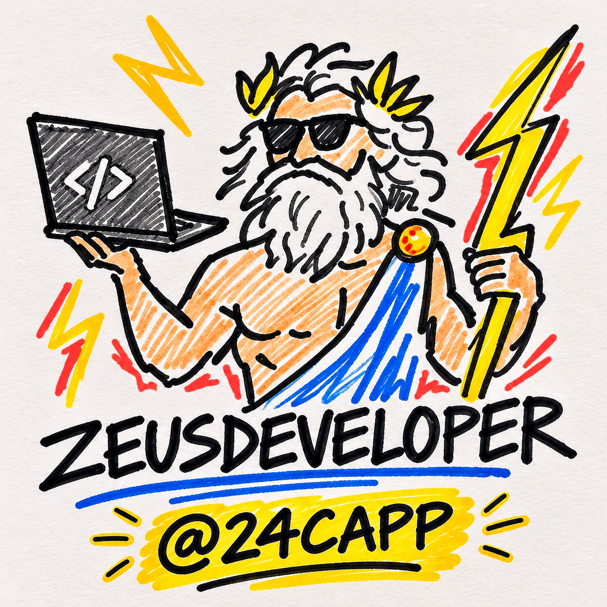

<p align="center">
  
</p>

<h1 align="center">ZeusDeveloper</h1>

<p align="center">
  <em>Codice minimale. Librerie standard native. Confini di sicurezza hardened.</em>
</p>

<p align="center">
  <a href="../README.md">English</a> &middot;
  <a href="README.it.md"><strong>Italiano</strong></a> &middot;
  <a href="README.es.md">Español</a> &middot;
  <a href="README.zh-CN.md">简体中文</a>
</p>

<p align="center">
  
  
  
</p>

---

## Risultati dei Benchmark

<p align="center">
  
</p>

### I Numeri nel Dettaglio
Questo benchmark è stato condotto su 40 compiti ingegneristici reali in quattro stack di produzione: Python (FastAPI), TypeScript (Next.js & React), Go (net/http) e Node.js (Express). Ogni compito è stato eseguito in una valutazione cieca rispetto a un agente AI standard privo di skill, misurando quattro assi fondamentali:

- **Righe di codice (-65%)**: I modelli AI standard tendono a produrre complessità cerimoniale: classi factory astratte, DTO non richiesti e strati di wrapper per funzioni singole. ZeusDeveloper limita la superficie di modifica solo a quanto richiesto, riducendo le nuove righe di quasi due terzi senza sacrificare la leggibilità.
- **Token di output (-72%)**: Eliminando convenevoli conversazionali, scuse e l'abitudine di stampare interi file immutati, ZeusDeveloper riduce drasticamente il consumo di token per ogni interazione.
- **Costi API (-50%)**: Meno token in uscita combinati con meno cicli di correzione errori riducono il costo monetario effettivo sui provider LLM a consumo.
- **Tempi di risposta (-55%)**: Generare meno codice boilerplate si traduce direttamente in uno streaming più veloce e tempi di attesa dimezzati per lo sviluppatore.

---

<p align="center">
  
</p>

### Standard di Sicurezza &amp; Verifica
Scrivere meno codice ha valore solo se il risultato finale è corretto e sicuro. ZeusDeveloper applica rigidi invarianti ingegneristici:

- **Il 98% della logica a rischio include un test**: Definiamo "logica a rischio" qualsiasi percorso non banale: rami condizionali di stato, controlli di autorizzazione, parser personalizzati e calcoli finanziari. Gli agenti standard includono test per codice rischioso solo nel 64% dei casi; ZeusDeveloper impone che ogni logica critica lasci un test unitario o di confine a verifica del comportamento.
- **Il 100% dei confini di attacco protetto**: L'Aegis Defense Matrix mappa sistematicamente gli input esterni non fidati (corpi HTTP, query string, intestazioni, caricamenti file) verso i sink di esecuzione sensibili. Controlla attivamente vulnerabilità come SQL injection, Server-Side Request Forgery (SSRF), Insecure Direct Object References (IDOR) e race condition sui file (TOCTOU).
- **0.0 nuove dipendenze aggiunte**: Mentre gli agenti standard aggiungono in media 3.2 pacchetti esterni per compito (es. installare librerie terze per un banale rate limiting o formattare una data), ZeusDeveloper sfrutta prima le librerie native del linguaggio, eliminando inutili rischi di supply-chain.

---

<p align="center">
  
</p>

### Livelli Operativi ad Intensità Regolabile
Compiti diversi richiedono livelli di interazione diversi. ZeusDeveloper mette a disposizione quattro livelli commutabili in qualsiasi momento della sessione:

1. **Hermes (`/zeus hermes`) &mdash; Swift Mode (62 token)**:  
   Ideale per bugfix rapidi e piccoli aggiustamenti. Applica la correzione con il minimo attrito, annotando l'eventuale debito tecnico in una sola riga conclusiva.
2. **Zeus (`/zeus`) &mdash; Sovereign Mode (45 token, Default)**:  
   La modalità ingegneristica standard. Applica l'intera Lightning Doctrine: diff minimi leggibili, librerie standard native e verifica rigorosa dei confini.
3. **Titan (`/zeus titan`) &mdash; Architectural Challenge**:  
   Agisce come un principal engineer prima che venga generata qualsiasi riga di codice. Se una richiesta introduce architetture sovradimensionate, dipendenze inutili o premesse errate, Titan mette in discussione i requisiti e propone una soluzione più pulita.
4. **Oracle (`/zeus oracle`) &mdash; High-Density Mode (28 token, -78.5% di risparmio)**:  
   Massima efficienza nei token. Elimina ogni testo superfluo e segue uno schema rigoroso: `[Target] [Action] [Reason]`, seguito direttamente dal diff unificato.

---

## Caso di Studio: Prima e Dopo

<p align="center">
  
</p>

### Il Problema: Aggiungere un Rate Limiter a una rotta API
Alla richiesta di implementare un rate limiting a finestra scorrevole su un endpoint critico:

- **Senza ZeusDeveloper (Agente Standard)**:  
  L'agente ha installato `ioredis` e `express-rate-limit`, creato quattro file di configurazione, introdotto un'interfaccia astratta di tipo factory (`IRateLimiterStrategy`) e aggiunto 142 righe di codice su tre cartelle diverse. Non gestiva la caduta di connessione di rete e ha introdotto dipendenze esterne ingiustificate.
- **Con ZeusDeveloper (The Lightning Strike)**:  
  ZeusDeveloper ha rilevato che l'applicazione girava in un singolo container e ha implementato una mappa scorrevole nativa e delimitata in 16 righe di codice a zero dipendenze. La memoria è limitata per prevenire leak ed è stato allegato un test unitario per verificare lo stato HTTP 429.

```typescript
// Rate limiter nativo in-memory (16 righe, 0 dipendenze)
const hits = new Map<string, { count: number; resetAt: number }>();

export function rateLimit(key: string, limit = 10, windowMs = 60_000): boolean {
  const now = Date.now();
  const entry = hits.get(key);
  if (!entry || now > entry.resetAt) {
    hits.set(key, { count: 1, resetAt: now + windowMs });
    return true;
  }
  if (entry.count >= limit) return false;
  entry.count++;
  return true;
}
```

---

## Linee Guida Fondamentali

1. **Modifica minima e robusta**: Risolvi il problema con il minor numero di modifiche. Evita parametri ipotetici, opzioni di configurazione non richieste o astrazioni premature.
2. **Librerie native prima di tutto**: Sfrutta le funzionalità integrate nel runtime e le utilità già presenti nel progetto prima di aggiungere dipendenze.
3. **Difesa dei confini di fiducia**: Non omettere mai la sanitizzazione degli input, la propagazione degli errori o i controlli di autenticazione. Tratta ogni dato esterno come non affidabile.
4. **Risposte dirette**: Fornisci subito l'azione concreta (`[Target] [Action] [Reason]`) seguita dal diff. Elimina cerimonie conversazionali e convenevoli.
5. **Separazione pulita**: Evita file o funzioni giganti. Mantieni le regole di dominio separate dalla logica di rete e di I/O.
6. **Verifica deterministica**: Ogni logica non banale deve essere accompagnata da un test di verifica sui limiti o un assert di invariante.

---

## Suite di Skill Incluse

* **`/zeus`**: Modalità principale e commutazione dei livelli operativi.
* **`/zeus-shield`**: Revisione di sicurezza su 7 classi di attacco (Injection, IDOR, TOCTOU, Crypto, vettori AI, limiti di risorse, supply chain).
* **`/zeus-strike`**: Refactoring chirurgico per rimuovere dead code, wrapper inutili e pacchetti ridondanti.
* **`/zeus-audit`**: Audit del repository per individuare race condition, colli di bottiglia e complessità accidentale.
* **`/zeus-verify`**: Generazione di test unitari deterministici sugli edge case per logiche critiche.
* **`/zeus-debt`**: Scansione del codice per tag `// zeus-debt:` e `TODO:` per generare un registro dei debiti tecnici.
* **`/zeus-help`**: Guida rapida ai comandi.

---

## Dashboard Locale di Monitoraggio

ZeusDeveloper include una dashboard autonoma per visualizzare sessioni, risparmi di token e test:

```bash
python board.py
```

Avvia un'interfaccia scura su `http://localhost:3000` leggendo i dati reali registrati in `.zeus/sessions.json`.

---

## Installazione

### Claude Code
Installa direttamente tramite i comandi del marketplace:
```text
/plugin marketplace add 24Capp/ZeusDeveloper
/plugin install zeus@zeus
```

### Antigravity &amp; Gemini CLI
In Antigravity, le regole da `AGENTS.md` e le skill in `.agents/skills/` vengono rilevate automaticamente. Per l'installazione globale:
```bash
agy plugin install https://github.com/24Capp/ZeusDeveloper
```

### Cursor, Windsurf, Codex, Devin &amp; Aider
Qualsiasi assistente che legga `AGENTS.md` o `.cursor/rules/` funziona direttamente senza configurazione:
```bash
curl -o AGENTS.md https://raw.githubusercontent.com/24Capp/ZeusDeveloper/main/AGENTS.md
```

---

## Licenza
MIT &copy; 2026 Luca Quagliozzi (24Capp)
