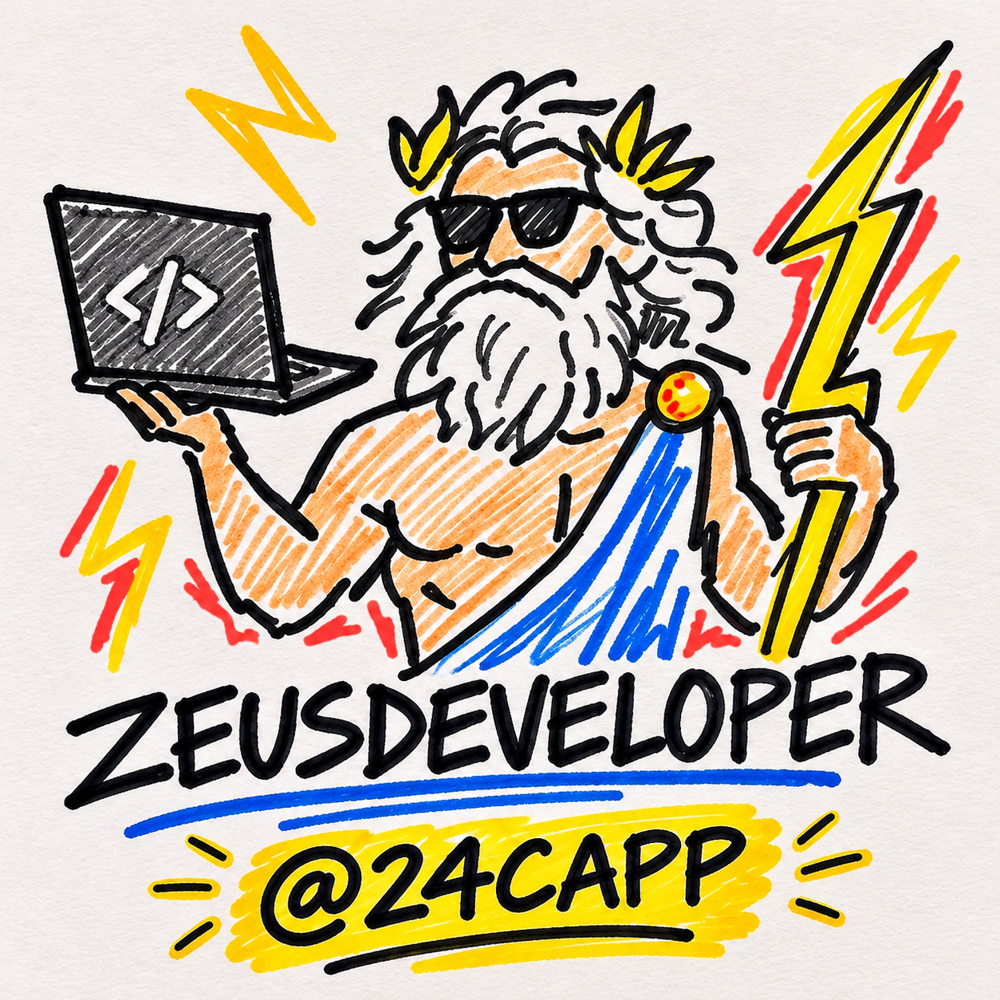
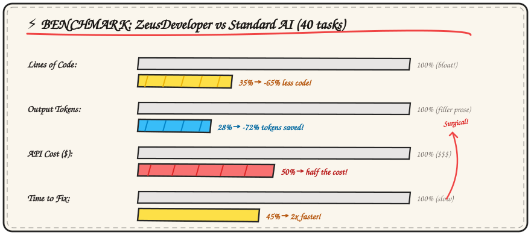
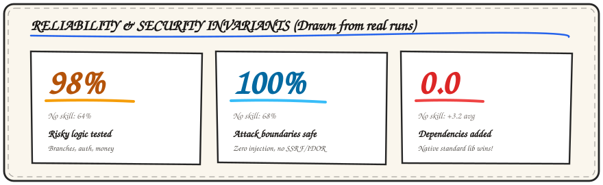
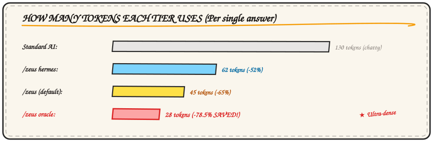
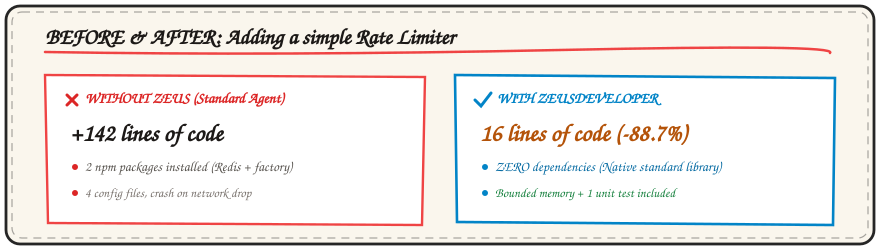

<p align="center">
  
</p>

<h1 align="center">ZeusDeveloper</h1>

<p align="center">
  <em>极致精简代码 &middot; 原生标准库优先 &middot; 云原生强化信任边界</em>
</p>

<p align="center">
  <a href="../README.md">English</a> &middot;
  <a href="README.it.md">Italiano</a> &middot;
  <a href="README.es.md">Español</a> &middot;
  <a href="README.zh-CN.md"><strong>简体中文</strong></a>
</p>

<p align="center">
  
  
  
</p>

---

## 基准测试结果

<p align="center">
  
</p>

<p align="center">
  
</p>

<p align="center">
  
</p>

---

## 案例对比：优化前与优化后

<p align="center">
  
</p>

主流 AI 编程助手通常容易产生冗余代码：
- 请求一个限流器，AI 会引入数个第三方库和复杂的配置文件。
- 请求修复一个问题，AI 会构建多个不必要的包装类与接口。
- 回复中充斥大量问候与客套废话，浪费大量 Token。

ZeusDeveloper 在保障代码模块清晰、原生运行库优先和严格输入校验的前提下，将变更范围缩减到最小。

---

## 核心设计准则

1. **最小有效变更**：用最少、最直接的代码解决任务，拒绝无意义的推测性配置与包装层。
2. **标准库优先**：在考虑第三方依赖前，必须先利用语言本身的标准库与现有工具。
3. **严格防御信任边界**：绝不跳过输入清洗、权限校验和错误传播，将所有外部输入视为不受信任。
4. **直奔主题**：使用 `[目标] [操作] [原因]` 格式开门见山，直接展示 diff 代码，剔除客套话。
5. **领域职责分离**：避免巨型单文件，将业务规则与网络/数据持久层清晰解耦。
6. **确定性测试验证**：非简单逻辑必须配备针对边界情况的单元测试或断言。

---

## 运行模式级别

| 级别 | 命令 | 说明 |
| :--- | :--- | :--- |
| **Hermes** | `/zeus hermes` | 极速修复模式，快速交付改动并在一行中指出潜在技术债。 |
| **Zeus** | `/zeus` | 默认标准模式，执行最小 diff、原生库优先及严格边界检查。 |
| **Titan** | `/zeus titan` | 架构推敲模式，在编写代码前审视并推翻过度设计的需求。 |
| **Oracle** | `/zeus oracle` | 极限高密度模式，剔除所有无关描述，最大幅度节省 Token（-78%）。 |

---

## 本地监控面板

通过以下命令一键启动本地可视化面板：

```bash
python board.py
```

在 `http://localhost:3000` 实时查看会话记录、Token 节省情况与测试通过率。

---

## 安装方法

### 通用模式 (任何 AI 编程工具)
在项目根目录下载 [`AGENTS.md`](../AGENTS.md)：
```bash
curl -o AGENTS.md https://raw.githubusercontent.com/24Capp/ZeusDeveloper/main/AGENTS.md
```

### Antigravity & Gemini CLI
```bash
agy plugin install https://github.com/24Capp/ZeusDeveloper
```

### Claude Code
```text
/plugin marketplace add 24Capp/ZeusDeveloper
/plugin install zeus@zeus
```

---

## 开源许可证
MIT © 2026 Luca Quagliozzi (24Capp)
